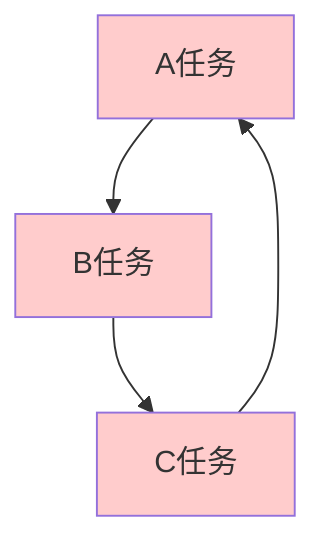
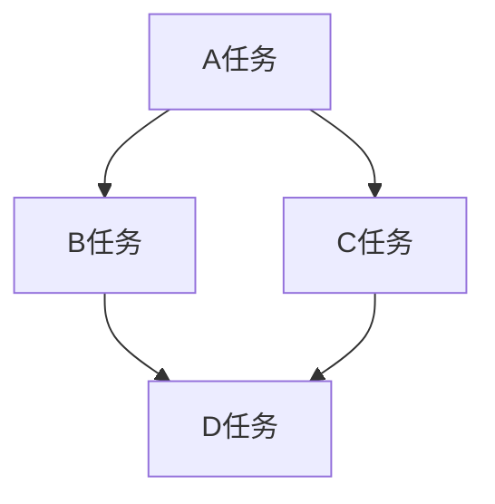
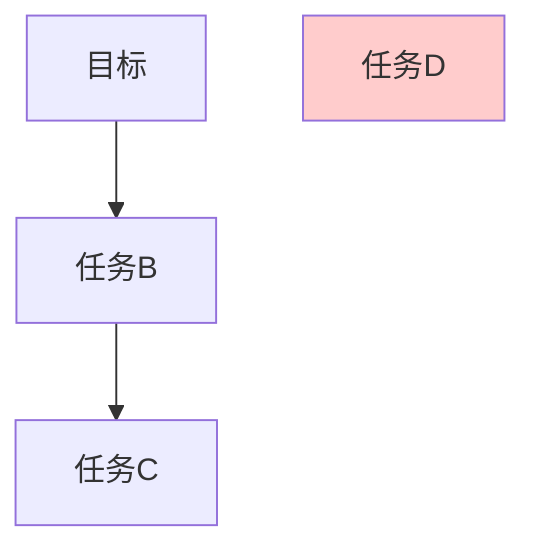
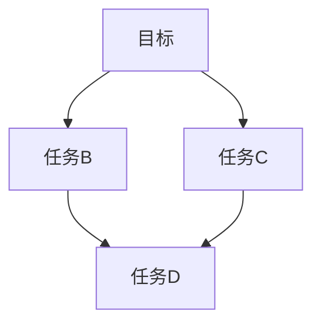
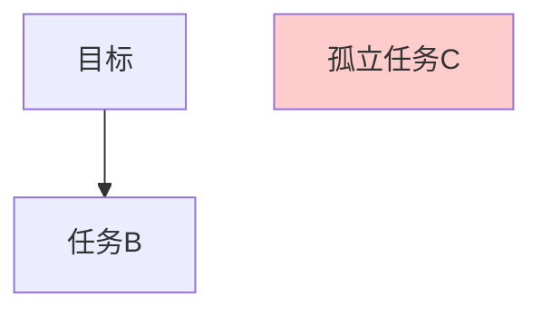
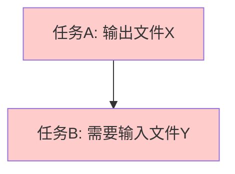
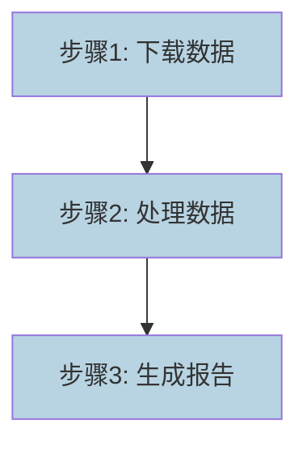
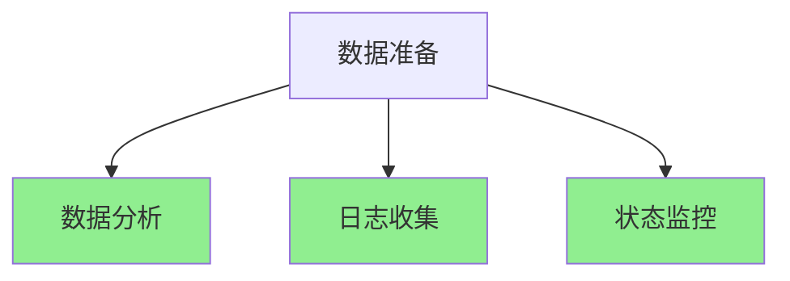
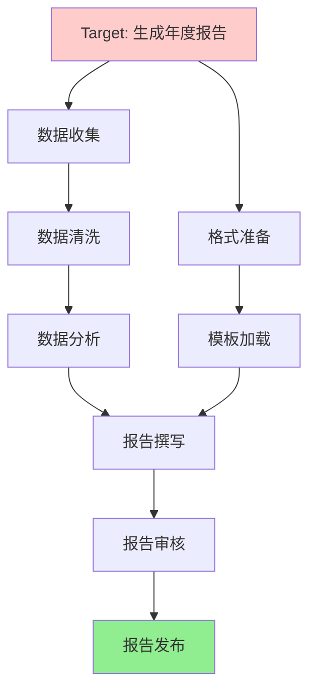
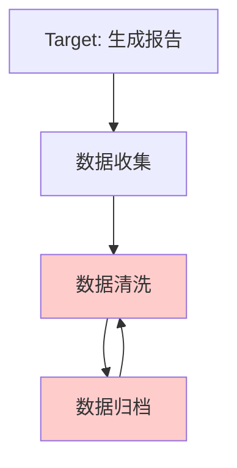

# 第7阶段交付物：DAG 约束规则手册

---

## 一、DAG 有向无环图基础原理

### 1.1 DAG 定义

DAG（Directed Acyclic Graph，有向无环图）是一种由顶点和边组成的图结构，其中：

| 属性 | 说明 |
|-----|------|
| **有向** | 每条边都有方向，从一个顶点指向另一个顶点 |
| **无环** | 不存在从某顶点出发经过若干条边又回到该顶点的路径 |
| **适用性** | 非常适合表达任务之间的依赖关系 |

### 1.2 基本术语

| 术语 | 定义 | 在本系统中的含义 |
|-----|------|---------------|
| **节点（Node）** | 图中的顶点 | 一个子任务 |
| **边（Edge）** | 节点之间的有向连接 | 子任务之间的依赖关系 |
| **入度（In-degree）** | 指向该节点的边的数量 | 该节点的前置依赖数量 |
| **出度（Out-degree）** | 从该节点指出的边的数量 | 该节点的后续依赖数量 |
| **路径（Path）** | 从节点 A 到节点 B 的有序边序列 | 执行链路 |
| **拓扑序（Topological Order）** | 节点的一种排序，满足所有依赖关系 | 任务执行顺序 |

### 1.3 DAG 在本系统中的作用

根据第二层拓扑依赖拆解层的职责：
- 将四元组任务拆解为 DAG 有向无环图结构
- 自动计算节点之间的依赖关系
- 严格区分串行依赖节点和并行独立节点

---

## 二、DAG 约束规则

### 2.1 合法性规则（必须满足）

#### 规则一：无循环依赖

| 属性 | 规范 |
|-----|------|
| **规则名称** | DAG-NO-CYCLE |
| **规则描述** | 图中不能存在任何环（Cycle） |
| **数学定义** | 不存在节点序列 [v1, v2, ..., vn]，使得从 v1 可以到达 vn，且从 vn 可以回到 v1 |
| **检测方法** | 使用深度优先搜索（DFS）或 Kahn 算法检测环的存在 |
| **违反后果** | 导致任务死锁，无法执行 |

**示例说明：**



❌ **非法**：A→B→C→A 存在循环依赖



✅ **合法**：无环结构，可以正常执行

---

#### 规则二：无悬空节点

| 属性 | 规范 |
|-----|------|
| **规则名称** | DAG-NO-DANGLING |
| **规则描述** | 所有节点都必须与最终目标（Target）有直接或间接的连接 |
| **数学定义** | 每个节点的可达集与目标节点的可达集之交非空 |
| **检测方法** | 从目标节点反向遍历，标记所有可达节点，未被标记的节点为悬空节点 |
| **违反后果** | 执行了与目标无关的冗余任务 |

**示例说明：**



❌ **非法**：D 是悬空节点，与目标无关联



✅ **合法**：所有节点都服务于目标

---

#### 规则三：无孤立节点

| 属性 | 规范 |
|-----|------|
| **规则名称** | DAG-NO-ISOLATED |
| **规则描述** | 不能存在与其他节点没有任何依赖关系的孤立节点 |
| **数学定义** | 每个节点的入度和出度不能同时为 0（根节点和叶节点除外） |
| **检测方法** | 检查所有非根非叶节点的入度和出度 |
| **违反后果** | 任务流程中存在无法整合的独立分支 |

**示例说明：**



❌ **非法**：C 是孤立节点，与其他任务无任何依赖关系

---

#### 规则四：输入输出匹配

| 属性 | 规范 |
|-----|------|
| **规则名称** | DAG-IO-MATCH |
| **规则描述** | 后序节点的输入必须等于前序节点的输出 |
| **数学定义** | 对于任意依赖边 (A, B)，B.input ⊆ A.output |
| **检测方法** | 逐条检查依赖边的输入输出匹配性 |
| **违反后果** | 任务之间无法正确传递数据 |

**示例说明：**



❌ **非法**：A 的输出（文件 X）与 B 的输入（文件 Y）不匹配

---

### 2.2 调度规则

#### 规则五：串行依赖标记

| 属性 | 规范 |
|-----|------|
| **规则名称** | DAG-SERIAL-MARK |
| **规则描述** | 当节点 B 依赖节点 A 时，A 和 B 必须串行执行 |
| **判定条件** | B.in-degree > 0 且 A 在 B 的前向路径上 |
| **执行要求** | 必须等 A 执行完成并通过校验后，才能开始执行 B |

**示例说明：**



✅ **串行执行**：A→B→C，必须按顺序执行

---

#### 规则六：并行独立标记

| 属性 | 规范 |
|-----|------|
| **规则名称** | DAG-PARALLEL-MARK |
| **规则描述** | 无相互依赖的节点可以并行执行 |
| **判定条件** | 节点 A 和节点 B 之间不存在任何有向路径 |
| **执行要求** | 可以同时开始执行，提高效率 |

**示例说明：**



✅ **并行执行**：B、C、D 可以同时执行

---

### 2.3 完整性规则

#### 规则七：根节点必须有 Target

| 属性 | 规范 |
|-----|------|
| **规则名称** | DAG-ROOT-HAS-TARGET |
| **规则描述** | 图中必须有一个或多个根节点（入度为 0），且必须与最终目标相关 |
| **检测方法** | 检查所有根节点的描述是否与 Task.target 相关 |
| **违反后果** | 无法确定任务起点 |

---

#### 规则八：叶节点必须满足 EndRule

| 属性 | 规范 |
|-----|------|
| **规则名称** | DAG-LEAF-SATISFY-END |
| **规则描述** | 所有叶节点（出度为 0）的执行结果必须满足 EndRule 的成功条件 |
| **检测方法** | 检查每个叶节点的输出是否对应 EndRule 中的检查项 |
| **违反后果** | 无法正常终止任务 |

---

## 三、DAG 禁例清单

### 3.1 绝对禁止项

| 禁例编号 | 禁例名称 | 禁例描述 | 违反后果 |
|---------|---------|---------|---------|
| **BAN-001** | 禁止自环 | 节点不能有一条指向自身的边 | 导致死锁 |
| **BAN-002** | 禁止双向边 | 不能同时存在 A→B 和 B→A | 形成隐式环 |
| **BAN-003** | 禁止多边 | 两个节点之间不能有多于一条边 | 依赖关系不明确 |
| **BAN-004** | 禁止逆向依赖 | 不能出现依赖指向执行顺序靠前的节点 | 违反因果律 |
| **BAN-005** | 禁止缺失根节点 | 不能存在没有任何前置条件的环 | 循环依赖的变体 |

### 3.2 强烈不建议项

| 建议编号 | 建议名称 | 建议描述 | 影响说明 |
|---------|---------|---------|---------|
| **ADV-001** | 不建议深嵌套 | 嵌套深度不宜超过 10 层 | 可维护性下降 |
| **ADV-002** | 不建议宽并行 | 单层并行节点不宜超过 20 个 | 资源消耗过大 |
| **ADV-003** | 不建议长路径 | 最长路径长度不宜超过 100 个节点 | 执行时间过长 |

---

## 四、非法拓扑结构识别

### 4.1 循环依赖识别

**算法：深度优先搜索（DFS）**

```python
def detect_cycle(graph):
    """
    检测图中是否存在环
    返回：True 表示存在环，False 表示无环
    """
    visited = set()
    rec_stack = set()
    
    def dfs(node):
        visited.add(node)
        rec_stack.add(node)
        
        for neighbor in graph.get(node, []):
            if neighbor not in visited:
                if dfs(neighbor):
                    return True
            elif neighbor in rec_stack:
                return True
        
        rec_stack.remove(node)
        return False
    
    for node in graph:
        if node not in visited:
            if dfs(node):
                return True
    return False
```

**时间复杂度：** O(V + E)，其中 V 是节点数，E 是边数

---

### 4.2 悬空节点识别

**算法：反向图遍历**

```python
def find_dangling_nodes(graph, target_nodes):
    """
    找出所有悬空节点
    graph: 邻接表表示的图
    target_nodes: 目标节点列表
    返回：悬空节点列表
    """
    reachable = set()
    
    def reverse_dfs(node):
        reachable.add(node)
        for neighbor in graph.get(node, []):
            if neighbor not in reachable:
                reverse_dfs(neighbor)
    
    for target in target_nodes:
        reverse_dfs(target)
    
    all_nodes = set(graph.keys())
    for edges in graph.values():
        all_nodes.update(edges)
    
    dangling = all_nodes - reachable
    return list(dangling)
```

---

### 4.3 孤立节点识别

**算法：入度出度分析**

```python
def find_isolated_nodes(graph):
    """
    找出所有孤立节点
    返回：孤立节点列表
    """
    in_degree = {}
    out_degree = {}
    
    for node in graph:
        in_degree[node] = 0
        out_degree[node] = len(graph[node])
    
    for node, neighbors in graph.items():
        for neighbor in neighbors:
            in_degree[neighbor] = in_degree.get(neighbor, 0) + 1
    
    isolated = []
    for node in set(list(graph.keys()) + [n for neighbors in graph.values() for n in neighbors]):
        is_root = in_degree.get(node, 0) == 0
        is_leaf = out_degree.get(node, 0) == 0
        if not is_root and not is_leaf and in_degree.get(node, 0) == 0 and out_degree.get(node, 0) == 0:
            isolated.append(node)
    
    return isolated
```

---

## 五、DAG 验证流程

### 5.1 验证步骤

| 步骤 | 验证内容 | 通过条件 |
|-----|---------|---------|
| **步骤 1** | 检测自环和双向边 | 不存在自环和双向边 |
| **步骤 2** | 检测循环依赖 | Kahn 算法或 DFS 检测无环 |
| **步骤 3** | 检测悬空节点 | 所有节点都可达目标节点 |
| **步骤 4** | 检测孤立节点 | 不存在与其他节点无关联的孤立节点 |
| **步骤 5** | 验证输入输出匹配 | 所有依赖边的 IO 匹配 |
| **步骤 6** | 验证根节点 | 存在与目标相关的根节点 |
| **步骤 7** | 验证叶节点 | 所有叶节点满足 EndRule |

### 5.2 验证决策表

| 验证结果 | 决策 | 说明 |
|---------|------|------|
| 全部通过 | 进入下一阶段 | DAG 结构合法 |
| 循环依赖 | 返回第二层重新拆解 | 调整子任务划分 |
| 悬空节点 | 返回第二层重新拆解 | 剔除无关任务 |
| 孤立节点 | 返回第二层重新拆解 | 整合孤立分支 |
| IO 不匹配 | 返回第二层重新拆解 | 修正依赖关系 |
| 根/叶节点问题 | 返回第一层重新建模 | 四元组定义有误 |

---

## 六、完整示例

### 6.1 合法的 DAG 示例

**任务：生成年度报告**



**验证结果：**
- ✅ 无循环依赖
- ✅ 无悬空节点
- ✅ 无孤立节点
- ✅ 输入输出匹配
- ✅ 根节点为 Target
- ✅ 叶节点满足 EndRule

---

### 6.2 非法的 DAG 示例

**存在的问题：**



**检测结果：**
- ❌ 循环依赖：B←C←B
- 建议：移除 C 节点或将 C 改为清洗后的归档步骤

---

## 七、验收标准自检

| 验收标准项 | 完成状态 |
|-----------|---------|
| 可识别循环依赖 | ✅ 已完成（DFS 算法） |
| 可识别悬空节点 | ✅ 已完成（反向图遍历） |
| 可识别非法拓扑结构 | ✅ 已完成（7 步验证流程） |

---

## 八、备注

本手册基于拓扑依赖拆解层的职责编制，为第二层开发提供 DAG 约束规则依据，确保生成的拓扑结构合法、可执行、可校验。
